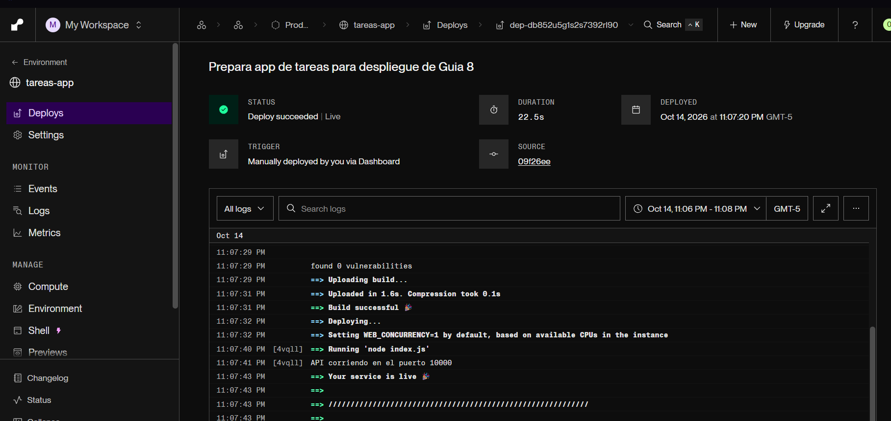
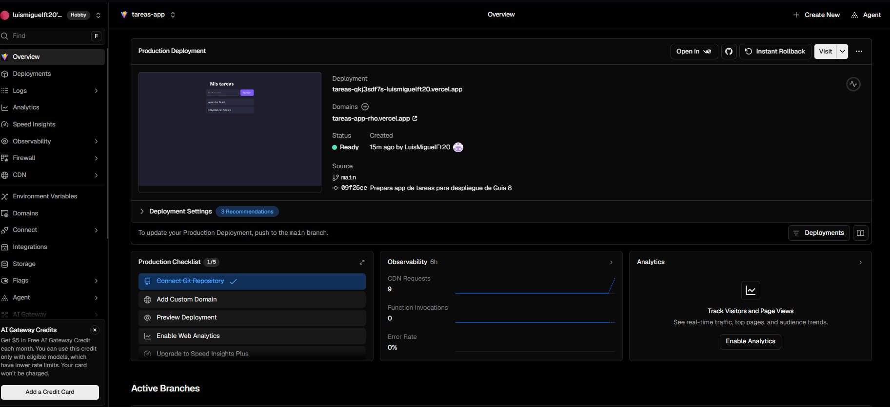
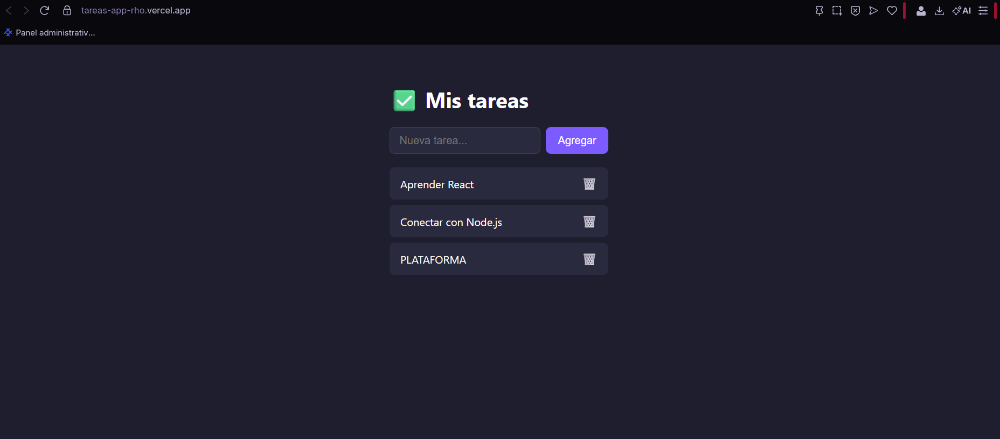

# Aplicación de Tareas — Guía 8

Aplicación full-stack desarrollada con React + Vite en el frontend y Node.js + Express en el backend. Ambas partes se comunican mediante HTTP y datos JSON.

## Enlaces del proyecto

- Frontend: https://tareas-app-rho.vercel.app
- API: https://tareas-app-b3w3.onrender.com/api/tareas
- Repositorio: https://github.com/LuisMiguelFt20/tareas-app

## Funcionalidades

- Listar tareas.
- Crear tareas con título obligatorio.
- Marcar y desmarcar tareas como completadas.
- Eliminar tareas.

## Estructura

- `client/`: interfaz de React y componentes.
- `server/`: API REST con Express.
- `capturas/`: evidencias del despliegue y funcionamiento.

## Instalación y ejecución local

Requisitos: Node.js y npm instalados, y Git para clonar el repositorio.

Clonar el proyecto:

```bash
git clone https://github.com/LuisMiguelFt20/tareas-app.git
cd tareas-app
```

En una terminal, iniciar el backend:

```bash
cd server
npm install
npm run dev
```

API local: http://localhost:3001/api/tareas

En otra terminal, desde la carpeta del proyecto, iniciar el frontend:

```bash
cd client
npm install
npm run dev
```

Frontend local: http://localhost:5173

Mantener ambas terminales abiertas. No se requiere Apache ni MySQL.

## Variables de entorno

| Variable | Dónde se configura | Propósito |
|---|---|---|
| `PORT` | Backend; Render la asigna automáticamente | Puerto del servidor; en local usa 3001 como respaldo. |
| `CLIENTE_URL` | Panel de Render | Origen del frontend autorizado mediante CORS. |
| `VITE_API_URL` | Panel de Vercel | Dirección completa de la API, incluyendo `/api/tareas`. |

En desarrollo, el código usa como valores de respaldo
`http://localhost:5173` para el origen permitido y
`http://localhost:3001/api/tareas` para la API.

El archivo `client/.env.example` documenta la configuración del frontend.
Si se necesita personalizarla localmente, copiarlo como `client/.env`,
editar el valor y reiniciar Vite.

Las variables con prefijo `VITE_` son visibles en el navegador y no deben
contener secretos. Los archivos `.env` reales se excluyen mediante
`.gitignore`.

## Endpoints de la API

| Método | Ruta | Acción | Respuesta exitosa |
|---|---|---|---|
| GET | `/api/tareas` | Listar tareas | 200 |
| POST | `/api/tareas` | Crear una tarea | 201 |
| PUT | `/api/tareas/:id` | Completar o descompletar | 200 |
| DELETE | `/api/tareas/:id` | Eliminar una tarea | 204 |

Para crear una tarea se envía JSON:

```json
{"titulo":"Entregar Guía 8"}
```

Para completarla se envía JSON:

```json
{"completada":true}
```

La API responde 400 si falta el título o está vacío, y 404 al intentar
actualizar o eliminar una tarea inexistente.

## Despliegue del backend en Render

1. Conectar el repositorio de GitHub y seleccionar la rama `main`.
2. Crear un Web Service con lenguaje Node.
3. Configurar Root Directory: `server`.
4. Configurar Build Command: `npm install`.
5. Configurar Start Command: `node index.js`.
6. Seleccionar el plan Free.
7. Configurar `CLIENTE_URL` con el origen del frontend:
   `https://tareas-app-rho.vercel.app`.
8. Desplegar y comprobar el estado Live.
9. Abrir la URL pública de la API con la ruta `/api/tareas`.

El backend utiliza `process.env.PORT || 3001` para aceptar el puerto
asignado por Render.

## Despliegue del frontend en Vercel

1. Importar el repositorio de GitHub.
2. Seleccionar la carpeta `client` como proyecto independiente.
3. Seleccionar el preset Vite.
4. Configurar Build Command: `npm run build`.
5. Configurar Output Directory: `dist`.
6. Agregar `VITE_API_URL` con el valor:
   `https://tareas-app-b3w3.onrender.com/api/tareas`.
7. Desplegar y comprobar el estado Ready.
8. Verificar que `CLIENTE_URL` en Render coincida con el dominio público
   de Vercel, sin una barra final.

Vite incorpora `VITE_API_URL` durante la compilación. Si cambia su valor
en Vercel, es necesario volver a desplegar el frontend.

Ambos servicios quedaron conectados al repositorio para publicar
actualizaciones desde la rama `main`.

## Pruebas realizadas en producción

| Prueba | Resultado |
|---|---|
| Abrir la aplicación y listar las tareas | Correcto |
| Agregar una tarea | Correcto |
| Marcarla como completada | Correcto |
| Recargar y comprobar que sigue completada | Correcto |
| Eliminarla y recargar para comprobar su ausencia | Correcto |

## Evidencias

### Backend desplegado en Render



### Frontend desplegado en Vercel



### Aplicación en producción



## Almacenamiento de datos

Las tareas se guardan en un arreglo en la memoria del backend.
Se mantienen al recargar el navegador mientras continúe el mismo
proceso del servidor, pero se pierden cuando este se reinicia.

Esta versión corresponde al ejercicio de la Guía 8 y no utiliza
una base de datos.